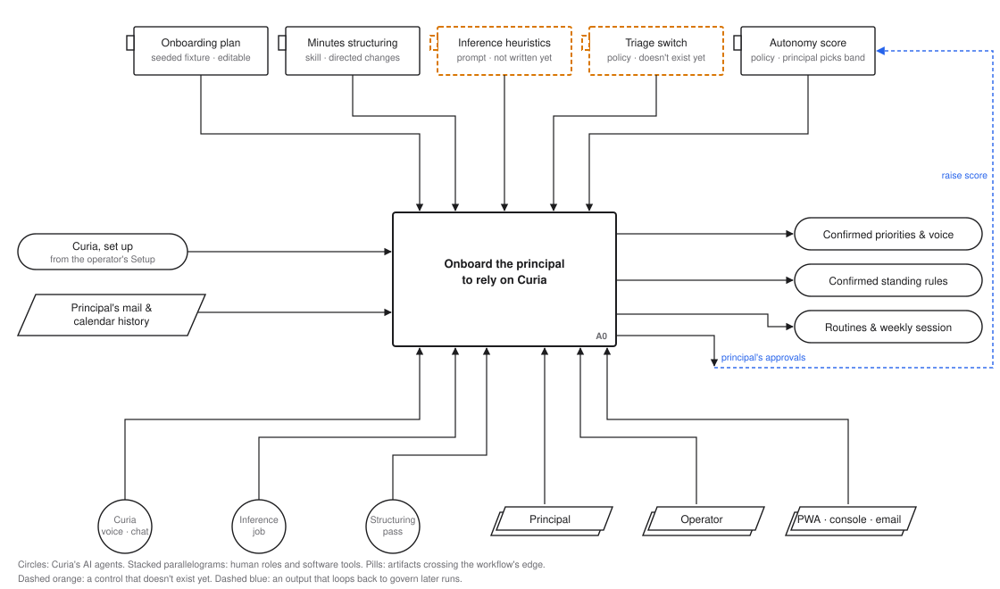
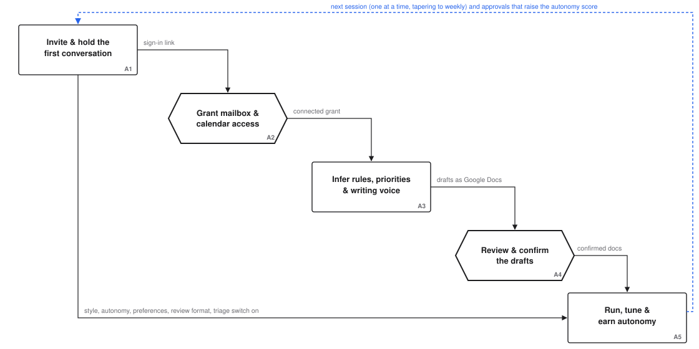

# Principal onboarding: a HAWD model

**Status:** Draft, 2026-10-30; revised 2026-11-01 with the design (Setup, then Onboarding)
**Companion to:** `docs/wip/2026-10-29-onboarding-journey-design.md` (the design). This model
describes the same journey from the principal's side and records what it changed in the design.
**Notation:** [Human-AI Workflow Design (HAWD) v0.9](https://github.com/overlapping-brock/hawd-standard),
by Brock Hart, Overlap. Licensed CC BY 4.0; Overlap is the originating studio.

## How to read this

HAWD extends IDEF0. Every step is a box with four kinds of arrow:

- **Inputs** enter from the left. The step transforms them.
- **Controls** enter from the top. They govern how the step runs and are not used up by it.
  Prompts, playbooks, policies and settings are controls.
- **Outputs** leave to the right.
- **Mechanisms** enter from the bottom. They do the work: people, tools and AI agents.

Shapes carry the role:

| Shape | Meaning |
|---|---|
| Rectangle | A step |
| **Hexagon** | A human judgment checkpoint: a step where a person must decide, and the decision can't be handed to anyone else |
| Tabbed rectangle | A control |
| **Circle** | An AI agent doing the work |
| Stacked parallelogram | A human role or software tool doing the work |
| Pill | An artifact crossing the edge of this workflow, in from another one or out to the next |
| Parallelogram | A data object passing through |

Two conventions are this model's own, not HAWD's: **dashed orange** marks a control that doesn't
exist yet, and **dashed blue** marks an output that loops back to govern later runs.

## Model frame

- **Viewpoint:** the principal. The operator's Setup is a separate workflow. Here it arrives as
  one input, "Curia, set up": every channel connected and verified, including the sign-in the
  principal will use for their own mailbox.
- **Purpose:** to document how the principal moves from a freshly set-up Curia to relying on it
  for real work, showing where they decide, what governs Curia's work around those decisions,
  and what they can see and check.
- **Questions the model must answer:**
  - **Q1 Expectations.** Before Curia changes anything the principal can see (mail labelled and
    leaving the inbox, holds or moves on the calendar, drafts piling up), how did they come to
    expect it? And did they choose how independent Curia is, rather than inherit a default?
  - **Q2 Check-ins.** Where does Curia check with the principal before acting, and how do those
    check-ins taper off as alignment is shown?
  - **Q3 "It gets me."** What governs Curia's inferences about the principal (rules, priorities
    and writing voice), and where do they edit a draft instead of filling in a blank page?

Confidence takes a couple of weeks, not one call. The design's "onboarding is done" point (drafts
confirmed, a weekly session agreed) marks the end of *capture*. Reliance builds after it, in A5.

## A0: context

**Onboard the principal to rely on Curia (A0)**

- **Inputs:** Curia, set up (from the operator's Setup); the principal's mail and calendar
  history.
- **Controls:**
  - **Onboarding plan.** Seeded from a fixture in the repo when Setup completes; the principal may edit it.
  - **Minutes structuring.** The existing `meeting-minutes-structuring` skill.
  - **Inference heuristics.** Not written yet (#2362).
  - **Triage switch.** Doesn't exist yet (#2360).
  - **Autonomy score.** Set from the band the principal picks in the first conversation (65, 75
    or 85); 75 until then.
- **Outputs:** confirmed standing rules, priorities and writing voice; agreed routines, ending in
  a weekly session; the principal's approvals, which loop back to raise the autonomy score.
- **Mechanisms:** Curia in voice or chat sessions, the inference job and the structuring pass (AI
  agents); the principal; the operator; the PWA, console, email and Google Docs.

## Decomposition: A1–A5

Only A2 and A4 are checkpoints. Check-ins in A5 are deliberately not: the autonomy score governs
them.

### A1: Invite and hold the first conversation

Curia invites the principal by email once Setup is complete; when the route is the phone app,
the email carries the link that installs it. The first
conversation runs by voice or chat, from an agenda generated from the onboarding plan.

- **Input:** Curia, set up; what the principal says about how they work.
- **Controls:**
  - **Onboarding plan**, including:
    - **Style and autonomy questions,** mostly multiple choice. The principal picks from
      described options; Curia turns the picks into its tone and detail settings and a starting
      autonomy band, and reads them back.
    - **The "what to expect" topic.** Its content is built from Curia's current settings when the
      agenda is generated, so it never promises behaviour Curia won't show: mail labelled and
      archived, and where it goes; tentative holds; whether booking meetings asks first at the
      band just chosen; how the principal wants to hear about unsent drafts.
  - **Invitation and nudge policy:** copy and frequency cap. Not written yet.
- **Outputs:** minutes; style and autonomy written to their stores; agreed routines (recap,
  drafts reminder); the review format chosen (call together, or review alone and text); the
  triage switch turned on once the principal has heard what to expect; the sign-in link sent.
- **Mechanisms:** Curia in a voice or chat session (AI); the structuring pass (AI); the principal.

Sessions are booked **one at a time**, at the end of each session, as the principal's interests
and availability shift. Nothing is created up front. Once the calendar is connected, each session
is a real event on it, and its agenda follows the event if the principal moves it.

### A2: Grant mailbox and calendar access (checkpoint)

- **What's decided:** whether Curia gets delegated access to the principal's own mail and calendar.
- **Criteria:** the principal understands what Curia will and won't do with it, as explained in A1.
- **Mechanisms:** the principal decides and signs in themselves, in the first conversation,
  through the link Curia sends. The operator prepared the sign-in during Setup but plays no part
  in the consent.
- **Outcomes:**
  - **Granted:** the grant arrives through the sign-in callback, which starts A3.
  - **Not yet:** Curia keeps working from its own inbox. The plan keeps the topic open for a
    later session. A3 and A4 wait.
- **Output:** the connected grant.

### A3: Infer rules, priorities and writing voice

- **Input:** about 90 days of calendar and mail history.
- **Controls:**
  - **Inference prompt and evidence heuristics.** Not written yet. This is the step that most
    decides whether Curia "gets" the principal, and it is the one with no written control.
  - **The principal's existing rules and voice settings:** keep them, and flag conflicts.
- **Outputs:** three drafts (working rules, priorities, writing voice), each item with the
  evidence behind it, delivered as Google Docs shared with the principal, with one email and a
  review session booked on their calendar.
- **Mechanisms:** the inference job on the strongest tier (AI); the principal's mailbox; Google
  Docs.

One read of the history produces all three drafts (#2362).

### A4: Review and confirm the drafts (checkpoint)

- **What's decided:** which inferred rules, priorities and voice traits are true of the principal.
- **Criteria:** the evidence shown with each item, and for voice, sample replies written in it.
- **How:** in the format the principal chose in A1.
  - **Together on a call:** Curia walks the drafts, strongest and most surprising items first.
  - **Alone, then text:** the principal edits or comments in the docs and texts Curia.
- **Outcomes:**
  - **Confirmed or corrected:** written into the Curia app (`/shared/inbox/rules.md`,
    `/shared/calendar/rules.md`, `/shared/principal/priorities.md`, the writing-voice profile).
    The Google Doc is marked as moved.
  - **Dropped:** not written.
  - **Not yet confirmed:** nothing is written; confirmation is per document.

  After writing, Curia sends a **receipt** listing what it set, with a console link to each
  document. The receipt doesn't wait for an answer.
- **Control:** the review agenda, generated by Curia from the onboarding plan.
- **Mechanisms:** the principal decides; Curia in a voice or chat session; Google Docs; email; the
  console.

### A5: Run, tune and earn autonomy

- **Inputs:** confirmed rules, priorities and voice; agreed routines.
- **Controls:**
  - **Autonomy score:** from the band the principal picked.
  - **Triage switch.**
  - **Minutes structuring:** for check-ins and the weekly session.
- **Outputs:**
  - **Visible work:** labels, holds, drafts and recaps.
  - **The principal's approvals and denials:** the daily scoring pass turns them into autonomy
    score changes once 30 actions have been scored.
  - **Weekly-session decisions:** autonomy changes, features kept or cleaned up, new plays,
    priority updates.
- **Mechanisms:** ceo-inbox, calendar and coordinator (AI); the scheduler; the principal.

Check-ins taper into a weekly session, which keeps looping back: each week's agenda is built from
what happened that week.

## What the model answers

- **Q1 Expectations.** A1's "what to expect" topic tells the principal what is coming. The triage
  switch makes it true: triage stays off until the principal has heard it. The drafts question
  closes the one route where work could sit unseen. The principal picks the starting autonomy
  band themselves.
- **Q2 Check-ins.** The autonomy score governs them, starting from the band the principal picked.
  At "Ask first" (75), creating or moving meetings (risk 80) asks first; tentative holds (risk 70)
  don't, so A1 names them. As the principal approves actions, the score rises and the check-ins
  stop; the weekly session reviews the evidence and proposes changes.
- **Q3 "It gets me."** A3 drafts rules, priorities and writing voice from the principal's own
  history. A4 turns them into edits in a shared doc instead of a blank page, and the receipt shows
  the result.

## Gaps: controls that must exist before this runs

| Control | Step | Status | Tracked in |
|---|---|---|---|
| Inference prompt and evidence heuristics | A3 | Not written; now a written deliverable of #2362 | #2362 |
| Triage switch (`ceo_inbox/triage`, off until A1) | A1, A5 | Doesn't exist | #2360 |
| "What to expect" topic, built from current settings | A1 | Not in any agenda | #2360 |
| Style and autonomy questions, and the mapping to settings | A1 | Not written | #2360 |
| Onboarding plan fixture (topics and progress) | A1, A4 | Doesn't exist | #2360 |
| Minutes structuring allows booking the next session, writing the plan, and writing style and autonomy | A1 | Its in-bounds list covers tasks and invite updates only | #2360 |
| Invitation and nudge policy (copy, frequency cap) | A1 | Left to the builder | #2360 |
| Principal mailbox sign-in | A2 | Doesn't exist; grants are made by hand | #2361 |

## Glossary

| Term | Meaning in this model |
|---|---|
| **Principal** | The executive Curia works for. |
| **Operator** | Whoever installs and runs Curia. Often the principal; sometimes an assistant or IT. |
| **Setup** | The operator's phase: install Curia, then connect its email, messaging to the principal, voice, the principal's mailbox sign-in and Google Docs. |
| **Onboarding** | The principal's phase: the invitation, the first conversation, the deep dive, the review, check-ins and the weekly session. |
| **Onboarding plan** | One editable document per principal, seeded from a repo fixture when Setup completes. It holds *what to cover* (sessions, topics) separately from *what's happened* (covered, left, the principal's timing and interests), so the agenda generator can tell "skipped" from "not part of onboarding". |
| **Directed change** | Something the principal explicitly asked for on a call. The minutes structuring skill carries it out (still within the autonomy score). Suggestions nobody asked for are mentioned, not done. |
| **Receipt** | A message sent after Curia applies a change, showing the result. It doesn't wait for a reply. Distinct from a **check-in**, which asks before acting. |
| **Autonomy score / band** | A 0–100 setting that decides which actions need the principal's approval. New installs start at 75, "approval-required", until the principal picks a band in the first conversation. |
| **Standing rules** | The principal's inbox and calendar rules, one `##` section per rule, in `/shared/inbox/rules.md` and `/shared/calendar/rules.md`. |
| **Triage switch** | A ceo-inbox config value that turns scheduled triage on or off. Written off when onboarding starts on a fresh install; missing means on, so existing installs are unaffected. |
| **Draft (rules, priorities or voice)** | An inference not yet confirmed. Nothing acts on it. |

## Notes on applying HAWD

This is a first application of HAWD v0.9 to Curia, and these notes record how it went.

**Where it helped.**

- **Undocumented controls.** Drawing the control rail surfaced controls that didn't exist. Two
  sat exactly on the steps that answer Q1 and Q3. The design had parked them under "left to the
  builder".
- **Checkpoints.** The checkpoint discipline cut the hexagons to two. A first pass put a
  checkpoint at every conversational decision. The standard's own warning against "using the
  human judgment checkpoint for routine reviews" was right, and the autonomy score was the better
  answer.
- **Viewpoint.** Choosing one viewpoint moved the operator's Setup out of the model. It also
  showed that the design's "done" is the end of capture, not reliance.
- **The feedback loop.** HAWD's fourth worked example has outputs that return as controls. That
  matched Curia twice: approvals feeding the autonomy score, and session outcomes feeding the
  onboarding plan.

**Where it strained.**

- **Time.** A diagram is a fixed picture, but check-ins taper and sessions are booked one at a
  time. Loops show this only loosely. The node narratives carry it.
- **Branches.** "Voice or chat" and "call together or review alone" have no place in the
  notation. They stay in the design's node narratives.
- **Decisions captured by an AI.** The principal decides on a call, but the decision reaches the
  system through minutes an AI wrote. HAWD has no mark for that hand-off. The minutes structuring
  skill and its confirmation message are the control here.
- **Agent-authored controls.** HAWD v0.9 names these as unresolved. Here each agenda is written
  by Curia, but always from a plan a human wrote and the principal can edit. That keeps the
  agent-authored control inside a human-authored one, which may be a useful pattern for the
  standard's open question.
- **Feel.** Anti-goals about how things feel, like "a requirements list that reads like a wall",
  are outside what HAWD models.
